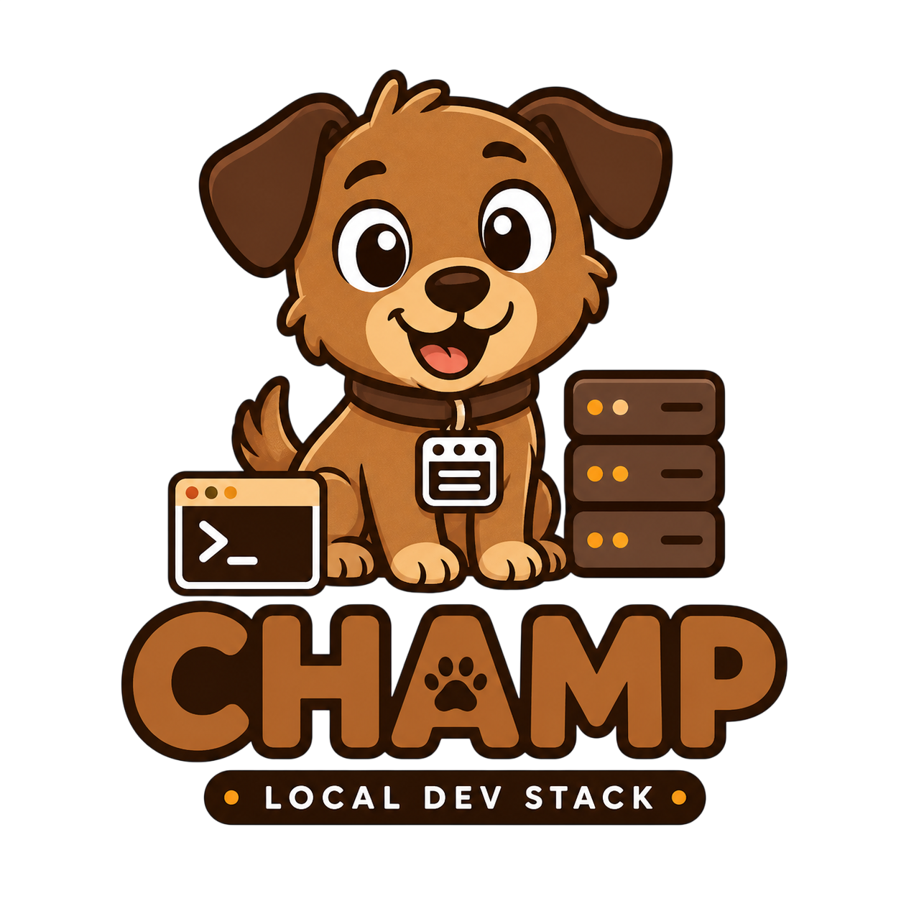

<div align="center">



## **CHAMP By Thirawat27**

*A light, self-updating local web development stack for Windows, macOS, and Linux*

**C**addy + **H**TTP(S) + **A**dminer / phpMy**A**dmin + **M**ySQL / PostgreSQL + **P**HP

[Features](#-features) • [Installation](#-installation) • [Usage](#-usage) • [AI agents](#-ai-agent-connector-mcp) • [Development](#-development) • [Releasing](#-releasing)

</div>

---

## 📖 Overview

CHAMP is a desktop app that runs a complete PHP development stack **without administrator rights**. Binaries, configuration, logs, and databases live in your user data folder; nothing system-wide is changed.

> This project is a fork of [CAMPP](https://github.com/KarnYong/campp) by KarnYong, rebuilt and extended by Thirawat27.

- 🚀 **No admin required** — everything runs in user space on unprivileged ports
- 🆕 **Always current** — PHP comes straight from php.net / windows.php.net, so installs and updates use the newest patch release (SHA-256 verified on Windows)
- 🩺 **Log Doctor** — explains why a service failed and how to fix it, with an 8M-parameter offline AI model downloaded automatically on first start
- 🤖 **AI agent connector** — a built-in MCP server for Claude Code, Cursor, and other coding agents
- 🔄 **Self-updating** — signed updates from GitHub Releases
- 🪶 **Light** — Rust backend, ~640 KB UI bundle, no Node.js/Python/Go runtimes to babysit

---

## ✨ Features

| Area | What you get |
| --- | --- |
| Stack | Caddy, PHP-FPM, MySQL or PostgreSQL, phpMyAdmin or Adminer; start / stop / restart everything or one service |
| Dashboard | Live request path (browser → Caddy → PHP-FPM → database), status lights, port readouts, CPU / RAM / network |
| PHP | Install, switch, and update PHP branches; the dashboard offers patch updates for the active PHP |
| Projects | Every folder in `projects/` is served at `http://localhost:8080/<folder>/`; common `.htaccess` rules are translated to Caddy |
| HTTPS Preview | Public `https://*.ngrok-free.app` link via ngrok (free ngrok authtoken required) |
| Log Doctor | 28 known failure patterns (ports, VC++ runtime, corrupted data, locks, permissions, …) with fixes and one-click actions |
| AI agents | Local MCP server (127.0.0.1 + bearer token) with status, environment, logs, diagnosis, database, HTTPS Preview, and service-control tools |
| Updates | Daily update check, one-click install and restart, minisign-verified packages |
| Guide | Detailed in-app guide in Thai and English (F1) |
| Tray | Closing the window keeps the stack running; quit from the tray |

---

## 🌐 Default addresses

| Service | Address |
| --- | --- |
| Website | http://localhost:8080 |
| Database tool | http://localhost:8080/phpmyadmin or http://localhost:8080/adminer |
| MySQL | 127.0.0.1:3306 — user `root`, empty password |
| PostgreSQL | 127.0.0.1:5432 — user `postgres`, local trust |
| PHP-FPM | 127.0.0.1:9000 (internal) |
| AI agent connector | http://127.0.0.1:47823/mcp (off by default) |

All ports can be changed in Settings. If a port is busy, CHAMP picks the next free one and tells you.

---

## 📥 Installation

Download the latest release from [Releases](https://github.com/thirawat27/CHAMP/releases):

- **Windows**: `.msi` or `-setup.exe`
- **macOS**: `.dmg` (Apple Silicon or Intel)
- **Linux**: `.AppImage` (self-updating), `.deb`, or `.rpm`

On first launch the setup wizard checks system libraries, lets you pick PHP / database versions (defaults are the newest), and downloads everything in parallel.

---

## 🚀 Usage

1. Press **Start** (`Ctrl/Cmd + S`).
2. Put a project in the projects folder (`Ctrl/Cmd + O`) and open `http://localhost:8080/<folder>/`.
3. Open the database tool with `Ctrl/Cmd + D`.
4. When a card turns red, press **Diagnose** for Log Doctor.
5. Press **F1** for the full guide.

### Keyboard shortcuts

| Shortcut | Action |
| --- | --- |
| `Ctrl/Cmd + S` / `R` / `X` | Start / restart / stop the stack |
| `Ctrl/Cmd + W` | Open the website |
| `Ctrl/Cmd + D` | Open phpMyAdmin / Adminer |
| `Ctrl/Cmd + O` / `L` | Open the projects / logs folder |
| `Ctrl/Cmd + T` | Terminal with PHP, MySQL, and PostgreSQL on `PATH` |
| `Ctrl/Cmd + ,` | Settings |
| `F1` | Guide |
| `?` | Shortcut help |
| `Esc` | Close a dialog or notification |

Shortcuts use physical key positions, so they work with Thai and other keyboard layouts.

---

## 🤖 AI agent connector (MCP)

Turn it on in **Settings → AI agent connector**, pick your client, copy the setup, and press **Test connection**. The panel has ready-made setup for Claude Code, Codex (`~/.codex/config.toml`), Cursor (`~/.cursor/mcp.json`), VS Code (`.vscode/mcp.json`), and Claude Desktop (via `npx mcp-remote`, needs Node.js). For Claude Code:

```bash
claude mcp add --transport http --scope user champ http://127.0.0.1:47823/mcp --header "Authorization: Bearer <token>"
```

| Tool | Purpose |
| --- | --- |
| `get_status` | State, port, and last error of every service, plus URLs |
| `get_environment` | Database credentials and `.env` lines, PHP version, document root, folders, versions |
| `list_projects` | Project folders and their URLs |
| `read_logs` | Recent log lines for a service |
| `diagnose_service` | Log Doctor diagnosis |
| `list_databases` | User databases on MySQL or PostgreSQL with connection details |
| `get_https_preview` | HTTPS Preview (ngrok) status and public URL |
| `start_*` / `stop_*` / `restart_*` | Stack and service control (hidden in read-only mode) |
| `create_database` | Create an empty database, never drops or overwrites (hidden in read-only mode) |
| `start_https_preview` / `stop_https_preview` | Open or close the public HTTPS URL (hidden in read-only mode) |

Security: localhost-only, 256-bit bearer token compared in constant time, browser requests (any `Origin` header) refused, optional read-only mode, and a dashboard notification for every agent action.

---

## ⚙️ Data and configuration

```text
%LOCALAPPDATA%\CHAMP\          (Windows; the system user-data folder elsewhere)
├── config/        settings.json, agent token, generated configs
├── logs/          service logs
├── models/        Log Doctor AI model (auto-downloaded)
├── mysql/data/    MySQL data
├── postgresql/data/
├── projects/      your websites
└── runtime/       Caddy, PHP, databases, phpMyAdmin / Adminer
```

- **Portable mode**: place a file named `champ-portable` next to the app, or set `CHAMP_DATA_DIR`.
- **Runtime catalog**: `src-tauri/runtime-config.json` is bundled and refreshed from upstream release feeds; see [CUSTOM_VERSIONS.md](src-tauri/CUSTOM_VERSIONS.md) to pin your own versions.

---

## 💻 Development

Prerequisites: Node.js 22+, pnpm 11+, Rust (stable), and the [Tauri prerequisites](https://tauri.app/start/prerequisites/) for your OS.

```bash
pnpm install
pnpm tauri dev
```

| Command | Purpose |
| --- | --- |
| `pnpm dev` | Vite dev server; in a plain browser the Tauri backend is mocked for UI work |
| `pnpm build` | Type-check (TypeScript 7) and build the UI |
| `pnpm lint` | oxlint |
| `pnpm test:run` | Vitest |
| `cd src-tauri && cargo test` | Rust tests |
| `cd src-tauri && cargo clippy --all-targets -- -D warnings` | Rust lint |

```text
src/                      React 19 UI (plain CSS design system in App.css)
├── components/           Dashboard, ServiceCard, SettingsPanel, LogDoctorModal, GuideModal, …
├── manual/content.ts     in-app guide (Thai + English)
├── stores/               language and update state (zustand)
└── hooks/                services, tunnel, Log Doctor model, agent connector
src-tauri/src/
├── commands.rs           IPC commands
├── process/manager/      Caddy, PHP-FPM, MySQL, PostgreSQL lifecycle
├── runtime/              catalog, PHP feeds, downloader, binary locator
├── doctor/               Log Doctor knowledge base + Model2Vec runtime
├── agent/                MCP server for AI agents
└── tunnel.rs             HTTPS Preview (ngrok)
```

---

## 📦 Releasing

Pushing a `v*` tag runs `.github/workflows/release.yml`, which builds every platform with `tauri-action`, signs the updater artifacts, and publishes them together with `latest.json`.

Required repository secrets:

- `TAURI_SIGNING_PRIVATE_KEY` — contents of the private key whose public key is in `src-tauri/tauri.conf.json`
- `TAURI_SIGNING_PRIVATE_KEY_PASSWORD` — only if the key has a password

Keep the private key out of the repository; losing it means existing installs can no longer verify updates.

---

## 📄 License

MIT — see [LICENSE](LICENSE). License holder: Thirawat Sinlapasomsak.

## 🙏 Acknowledgments

[CAMPP](https://github.com/KarnYong/campp) by KarnYong · [Tauri](https://tauri.app/) · [Caddy](https://caddyserver.com/) · [PHP](https://www.php.net/) · [static-php-cli](https://static-php.dev/) · [MySQL](https://www.mysql.com/) · [PostgreSQL](https://www.postgresql.org/) · [phpMyAdmin](https://www.phpmyadmin.net/) · [Adminer](https://www.adminer.org/) · [Model2Vec](https://github.com/MinishLab/model2vec)

<div align="center">

Made with ❤️ by [Thirawat27](https://github.com/thirawat27) · [Issues](https://github.com/thirawat27/CHAMP/issues)

</div>
