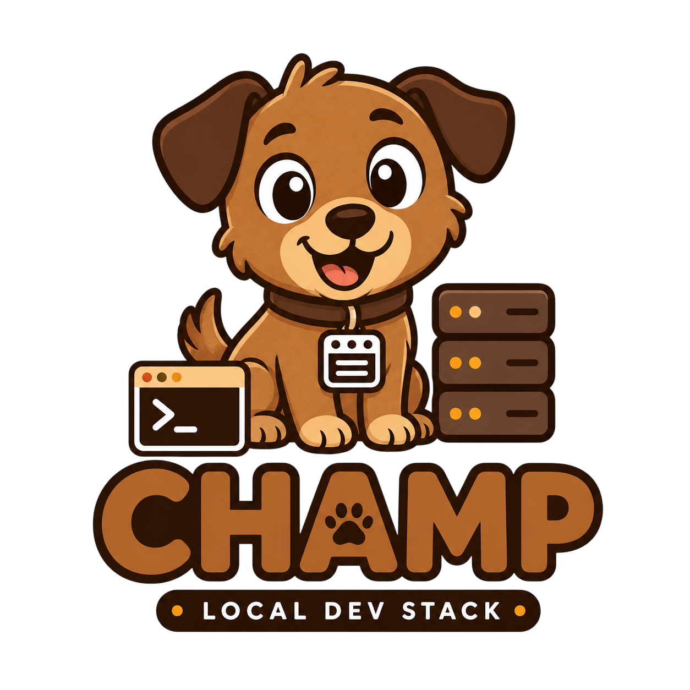

<div align="center">



## **CHAMP By Thirawat27**

*A light, self-updating local web development stack for Windows, macOS, and Linux*

**C**addy + **H**TTP(S) + **A**dminer / phpMy**A**dmin + **M**ySQL / PostgreSQL + **P**HP

[Features](#-features) • [Installation](#-installation) • [Usage](#-usage) • [AI agents](#-ai-agent-connector-mcp) • [Development](#-development) • [Releasing](#-releasing)

</div>

---

## 📖 Overview

CHAMP is a desktop app that runs a complete PHP development stack **without administrator rights**. Binaries, configuration, logs, and databases live in your user data folder; nothing system-wide is changed.

> This project is a fork of [CAMPP](https://github.com/KarnYong/campp) by KarnYong, rebuilt and extended by Thirawat27.

- 🚀 **No admin required** — everything runs in user space on unprivileged ports
- 🆕 **Always current** — PHP comes straight from php.net / windows.php.net, so installs and updates use the newest patch release (SHA-256 verified on Windows)
- 🩺 **Log Doctor** — explains why a service failed and how to fix it, with a 7.6M-parameter offline AI model downloaded automatically on first start
- 🧩 **Any PHP framework** — detects Laravel, Symfony, WordPress, CodeIgniter, CakePHP, Slim, Yii, and more, and gives ready configuration in each framework's own form
- 🤖 **AI agent connector** — a built-in MCP server that lets Claude Code, Cursor, and other coding agents do everything the app does
- 🔄 **Self-updating** — signed updates from GitHub Releases
- 🪶 **Light** — Rust backend, ~460 KB UI bundle, no Node.js/Python/Go runtimes to babysit

---

## ✨ Features

| Area | What you get |
| --- | --- |
| Stack | Caddy, PHP-FPM, MySQL or PostgreSQL, phpMyAdmin or Adminer; start / stop / restart everything or one service |
| Dashboard | Live request path (browser → Caddy → PHP-FPM → database), status lights, port readouts, CPU / RAM / network |
| PHP | Install, switch, and update PHP branches; the dashboard offers patch updates for the active PHP; optional Xdebug step debugging (trigger mode) |
| Projects | Every folder in `projects/` is served at `http://localhost:8080/<folder>/` and at its own domain `http://<folder>.localhost:8080/` (from `public/` when it has one; no hosts file, no admin rights, no restart for new folders); common `.htaccess` rules are translated to Caddy |
| Frameworks | Framework and required PHP detected from `composer.json`; configuration lines for Laravel, Symfony, WordPress, CodeIgniter, CakePHP, a generic DSN form (Slim, Yii, Laminas, plain PHP), and the `CHAMP_*` variables every PHP request already gets |
| HTTPS Preview | Public `https://*.ngrok-free.app` link via ngrok (free ngrok authtoken required) |
| Add-on services | Optional Redis (cache/queue), Mailpit (catches outgoing mail, never delivers it), Meilisearch (search), Centrifugo (realtime WebSocket), and RustFS (S3 storage); pinned, SHA-256-verified downloads that start with the stack. Register your own services too (for example Valkey), and run project background tasks such as `artisan queue:work` (`Ctrl/Cmd + E`) |
| Log Doctor | 28 known failure patterns (ports, VC++ runtime, corrupted data, locks, permissions, …) with fixes and one-click actions |
| AI agents | Local MCP server (127.0.0.1 + bearer token) that covers the whole app: status, environment, projects and framework config, logs and diagnosis, databases and table schema, caught mail, add-ons, PHP and Xdebug, settings and ports, HTTPS Preview, plus resources and prompts |
| Updates | Daily update check, one-click install and restart, minisign-verified packages |
| Guide | Detailed in-app guide in Thai and English (F1) |
| Tray | Closing the window keeps the stack running; quit from the tray |

---

## 🌐 Default addresses

| Service | Address |
| --- | --- |
| Website | http://localhost:8080 |
| Database tool | http://localhost:8080/phpmyadmin or http://localhost:8080/adminer |
| MySQL | 127.0.0.1:3306 — user `root`, empty password |
| PostgreSQL | 127.0.0.1:5432 — user `postgres`, local trust |
| PHP-FPM | 127.0.0.1:9000 (internal) |
| AI agent connector | http://127.0.0.1:47823/mcp (off by default) |
| Redis (add-on) | 127.0.0.1:6379 |
| Mailpit (add-on) | SMTP 127.0.0.1:1025, inbox http://127.0.0.1:8025 |
| Meilisearch (add-on) | http://127.0.0.1:7700 |
| Centrifugo (add-on) | http://127.0.0.1:8000 (API `/api`, WebSocket `/connection/websocket`, admin UI) |
| RustFS (add-on) | S3 API http://127.0.0.1:9100, console http://127.0.0.1:9101 — `rustfsadmin` / `rustfsadmin` |
| Xdebug | connects to your IDE on port 9003 |

All ports can be changed in Settings (add-on ports in Add-on services). If a stack port is busy, CHAMP picks the next free one and tells you. Add-ons never move: your project's `.env` names their port, so a busy add-on port is reported instead. RustFS has no Intel Mac build.

---

## 📥 Installation

Download the latest release from [Releases](https://github.com/thirawat27/CHAMP/releases):

- **Windows**: `.msi` or `-setup.exe`
- **macOS**: `.dmg` (Apple Silicon or Intel)
- **Linux**: `.AppImage` (self-updating), `.deb`, or `.rpm`

On first launch the setup wizard checks system libraries, lets you pick PHP / database versions (defaults are the newest), and downloads everything in parallel.

---

## 🚀 Usage

1. Press **Start** (`Ctrl/Cmd + S`).
2. Put a project in the projects folder (`Ctrl/Cmd + O`) and open `http://localhost:8080/<folder>/`.
3. Open the database tool with `Ctrl/Cmd + D`.
4. Press `Ctrl/Cmd + E` for add-ons. Its **Project configuration** tab gives the lines for your project's framework, and **Background tasks** runs queue workers.
5. When a card turns red, press **Diagnose** for Log Doctor.
6. Press **F1** for the full guide.

Settings (`Ctrl/Cmd + ,`) is grouped into General, Ports, PHP (with Xdebug), Database, Add-on services, and AI and Log Doctor.

### Xdebug (Windows)

1. Run `php -v` in the CHAMP terminal (`Ctrl/Cmd + T`) to see the PHP version and TS/NTS build.
2. Download the matching DLL from [xdebug.org/download](https://xdebug.org/download) into the `ext` folder shown in **Settings → PHP**.
3. Turn on **Xdebug** there; PHP restarts.
4. In your IDE listen on port 9003, set a breakpoint, and open the page with `?XDEBUG_TRIGGER=1`.

CHAMP's static PHP on macOS/Linux cannot load Xdebug.

### Keyboard shortcuts

| Shortcut | Action |
| --- | --- |
| `Ctrl/Cmd + S` / `R` / `X` | Start / restart / stop the stack |
| `Ctrl/Cmd + W` | Open the website |
| `Ctrl/Cmd + D` | Open phpMyAdmin / Adminer |
| `Ctrl/Cmd + O` / `L` | Open the projects / logs folder |
| `Ctrl/Cmd + T` | Terminal with PHP, MySQL, and PostgreSQL on `PATH` |
| `Ctrl/Cmd + ,` | Settings |
| `Ctrl/Cmd + E` | Add-on services, project configuration, and background tasks |
| `Ctrl/Cmd + M` | Mailpit inbox (when running) |
| `F1` | Guide |
| `?` | Shortcut help |
| `Esc` | Close a dialog or notification |

Shortcuts use physical key positions, so they work with Thai and other keyboard layouts.

---

## 🤖 AI agent connector (MCP)

Turn it on in **Settings → AI agent connector**, pick your client, copy the setup, and press **Test connection**. The panel has ready-made setup for Claude Code, Codex (`~/.codex/config.toml`), Cursor (`~/.cursor/mcp.json`), VS Code (`.vscode/mcp.json`), and Claude Desktop (via `npx mcp-remote`, needs Node.js). For Claude Code:

```bash
claude mcp add --transport http --scope user champ http://127.0.0.1:47823/mcp --header "Authorization: Bearer <token>"
```

Read tools:

| Tool | Purpose |
| --- | --- |
| `get_status` / `get_environment` | Service state, ports, URLs, database credentials, PHP, add-ons, folders, versions |
| `list_projects` / `get_project` | Projects with URLs; one project's framework, required vs running PHP, setup advice, and recommended configuration |
| `get_env_profiles` | Configuration for Laravel, Symfony, WordPress, CodeIgniter, CakePHP, generic DSN, or `getenv` |
| `read_logs` / `diagnose_service` | Recent log lines and Log Doctor diagnosis |
| `list_databases` / `list_tables` / `describe_table` | Databases, tables, and columns (fixed read-only catalog queries) |
| `get_addons` / `read_addon_log` | Add-on state, ports, URLs, and logs |
| `list_mail` / `read_mail` | Mail caught by Mailpit, with the links inside (check sign-up and reset emails) |
| `get_php_info` / `list_php_versions` | Extensions, ini values, Xdebug, and every PHP branch on offer |
| `get_settings` / `check_ports` / `get_system_info` | Saved settings, which ports are free or taken, and system info |
| `get_https_preview` / `list_workers` | HTTPS Preview status and background tasks |

Write tools (hidden in read-only mode):

| Tool | Purpose |
| --- | --- |
| `start_*` / `stop_*` / `restart_*` | Stack and service control |
| `create_database` | Create an empty database; never drops or overwrites |
| `update_settings` | Change core ports and startup options (validated; a running stack restarts) |
| `install_php_version` / `switch_php_version` / `set_xdebug` | Install, switch, and debug PHP |
| `switch_database_engine` / `switch_database_tool` | MySQL or PostgreSQL; phpMyAdmin or Adminer |
| `install_addon` / `set_addon_enabled` / `set_addon_port` / `start_addon` / `stop_addon` | Add-on control |
| `start_worker` / `stop_worker` | Run the background tasks you defined |
| `start_https_preview` / `stop_https_preview` | Open or close the public HTTPS URL |

It also offers resources (`champ://status`, `champ://environment`, `champ://logs/{service}`, `champ://projects/{name}`, `champ://env/{profile}`, …) and prompts (connect a project, diagnose a problem, test an email flow).

Security: localhost-only, 256-bit bearer token compared in constant time, browser requests (any `Origin` header) refused, optional read-only mode, and a dashboard notification for every agent action. No tool deletes data or runs arbitrary SQL or shell commands; custom add-ons, background tasks, and the ngrok authtoken are defined by you only.

---

## ⚙️ Data and configuration

```text
%LOCALAPPDATA%\CHAMP\          (Windows; the system user-data folder elsewhere)
├── addons/        add-on data (redis/, mailpit/, meilisearch/, centrifugo/, rustfs/, custom/<id>/)
├── config/        settings.json, agent token, generated configs
├── logs/          service logs
├── models/        Log Doctor AI model (auto-downloaded)
├── mysql/data/    MySQL data
├── postgresql/data/
├── projects/      your websites
└── runtime/       Caddy, PHP, databases, phpMyAdmin / Adminer, addons/
```

- **Portable mode**: place a file named `champ-portable` next to the app, or set `CHAMP_DATA_DIR`.
- **Runtime catalog**: `src-tauri/runtime-config.json` is bundled and refreshed from upstream release feeds; see [CUSTOM_VERSIONS.md](src-tauri/CUSTOM_VERSIONS.md) to add custom versions (only custom PHP ids survive a catalog refresh).

---

## 💻 Development

Prerequisites: Node.js 22.22.2+ (or 24.15+), pnpm 12, Rust (stable), and the [Tauri prerequisites](https://tauri.app/start/prerequisites/) for your OS.

```bash
pnpm install
pnpm tauri dev
```

| Command | Purpose |
| --- | --- |
| `pnpm dev` | Vite dev server; in a plain browser the Tauri backend is mocked for UI work |
| `pnpm build` | Type-check (TypeScript 7) and build the UI |
| `pnpm lint` | oxlint |
| `pnpm test:run` | Vitest |
| `cd src-tauri && cargo test` | Rust tests |
| `cd src-tauri && cargo clippy --all-targets -- -D warnings` | Rust lint |

```text
src/                      React 19 UI (plain CSS design system in App.css)
├── components/           Dashboard, ServiceCard, SettingsPanel, AddonsModal, LogDoctorModal, GuideModal, …
│   ├── addons/           env profiles, custom add-on form, background tasks
│   └── settings/         one file per Settings category section
├── manual/content.ts     in-app guide (Thai + English)
├── stores/               language and update state (zustand)
└── hooks/                services, tunnel, add-ons, Log Doctor model, agent connector
src-tauri/src/
├── commands/             IPC commands
├── process/manager/      Caddy, PHP-FPM, MySQL, PostgreSQL lifecycle
├── runtime/              catalog, PHP feeds, downloader, binary locator
├── addons/               add-on specs, pinned catalog, runtime, custom add-ons, background tasks
├── envprofile.rs         framework configuration profiles
├── projects.rs           project domains and framework detection
├── xdebug.rs             Xdebug detection and php.ini lines
├── doctor/               Log Doctor knowledge base + Model2Vec runtime
├── agent/                MCP server for AI agents (tools, resources, prompts)
└── tunnel/               HTTPS Preview (ngrok)
```

---

## 📦 Releasing

Pushing a `v*` tag runs `.github/workflows/release.yml`, which builds every platform with `tauri-action`, signs the updater artifacts, and publishes them together with `latest.json`.

Before tagging, set the version in `package.json`, `src-tauri/tauri.conf.json`, `src-tauri/Cargo.toml`, and `src-tauri/Cargo.lock`, and add a `## [x.y.z]` section to [CHANGELOG.md](CHANGELOG.md). The workflow uses that section as the release notes and the in-app update notes, and fails when it is missing.

Required repository secrets:

- `TAURI_SIGNING_PRIVATE_KEY` — contents of the private key whose public key is in `src-tauri/tauri.conf.json`
- `TAURI_SIGNING_PRIVATE_KEY_PASSWORD` — only if the key has a password

Keep the private key out of the repository; losing it means existing installs can no longer verify updates.

---

## 📄 License

MIT — see [LICENSE](LICENSE). License holder: Thirawat Sinlapasomsak.

## 🙏 Acknowledgments

[CAMPP](https://github.com/KarnYong/campp) by KarnYong · [Tauri](https://tauri.app/) · [Caddy](https://caddyserver.com/) · [PHP](https://www.php.net/) · [static-php-cli](https://static-php.dev/) · [MySQL](https://www.mysql.com/) · [PostgreSQL](https://www.postgresql.org/) · [phpMyAdmin](https://www.phpmyadmin.net/) · [Adminer](https://www.adminer.org/) · [Model2Vec](https://github.com/MinishLab/model2vec)

<div align="center">

Made with ❤️ by [Thirawat27](https://github.com/thirawat27) · [Issues](https://github.com/thirawat27/CHAMP/issues)

</div>
